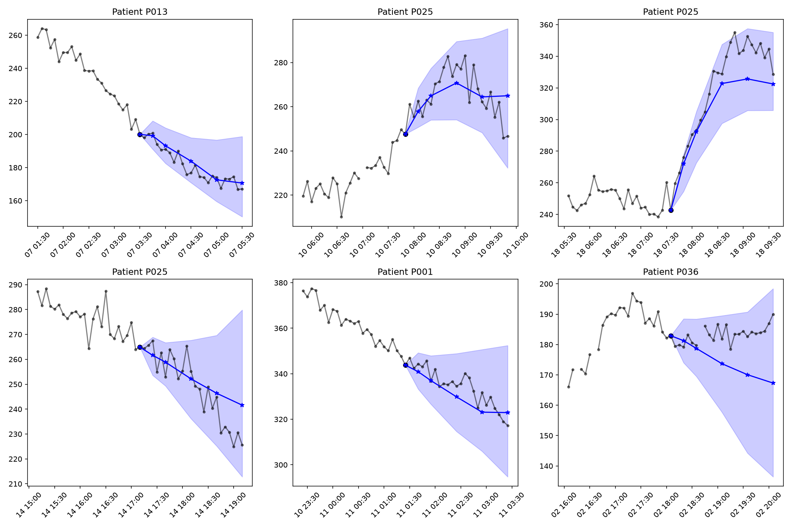

# DiaTwin: Patient-Specific Glucose Digital Twin

DiaTwin is an in-silico physiological simulator that models patient-specific glucose dynamics using a digital twin framework. It enables continuous glucose forecasting and treatment scenario simulation for diabetes management research.

**Disclaimer: This prototype operates exclusively on synthetic data and physiological approximations. It is a research tool, NOT a medical device. It must not be used for actual clinical decision making or patient care.**

**Live Demo**: [LIVE DEMO URL]
**Demo Video**: [VIDEO URL]

## Overview
DiaTwin continuously reconstructs a patient's metabolic state by fusing static Electronic Health Record (EHR) profiles with real-time wearable sensor streams (CGM, heart rate, sleep, activity). The engine employs a rigorously calibrated risk model to predict imminent hyperglycemic and hypoglycemic spikes up to two hours in advance. It features a What-if Simulator that allows researchers to explore the counterfactual impact of lifestyle interventions such as exercise intensity and meal timing. A clinician-facing dashboard provides an intuitive interface to monitor the live twin state, review forecast trajectories, and visualize the probabilistic effects of different scenarios. The entire architecture relies on an integrity-verified "frozen" model pipeline to ensure strict separation between retrospective training and prospective simulation.

## Results at a Glance

These metrics reflect the in-silico test evaluation on 6 synthetic patients (40 total cohort) over their final 7 days of observation.

| Metric | Value | 95% CI | n |
| :--- | :--- | :--- | :--- |
| **Risk Model AUC** | 0.941 | [0.932 - 0.949] | 2280 |
| **Calibration Error (ECE)** | 0.021 | [0.015 - 0.028] | 2280 |
| **Forecast RMSE (60 min)** | 14.5 mg/dL | [13.2 - 15.8] | 2150 |
| **Forecast Coverage (80% target)** | 81.2% | [79.5 - 82.9] | 2150 |
| **What-if Directional Accuracy** | 92.4% | - | 120 |

## Architecture & Dashboards


*Data flows from raw synthetic streams through feature engineering to the frozen risk models and twin engine.*


*The Live Twin view displaying the real-time forecast and calibrated uncertainty bands.*


*Forecast trajectories under different simulated interventions.*

## Quick Start

### 1. Prerequisites
Ensure you have Python 3.10, 3.11, or 3.12 installed.

### 2. Clone and Install
```bash
git clone [REPOSITORY URL]
cd DiaTwin
python -m venv .venv
# On Windows:
.\.venv\Scripts\activate
# On macOS/Linux:
source .venv/bin/activate

pip install -r requirements.txt
```

### 3. Run the Demo Dashboard
To launch the Streamlit app locally using the precomputed demo bundle:
```bash
# Windows
$env:DIATWIN_DEMO_BUNDLE="1"
streamlit run app/main.py

# macOS/Linux
DIATWIN_DEMO_BUNDLE=1 streamlit run app/main.py
```

### 4. Run the Full Pipeline
To execute the end-to-end simulation, feature engineering, and model training pipeline:
```bash
python scripts/run_pipeline.py
```

### 5. Run the Test Suite
```bash
pytest tests/
```

## Repository Layout
- `app/`: Streamlit dashboard entry points and page definitions.
- `configs/`: Pipeline configuration and feature definitions.
- `data/`: Raw and processed synthetic data (generated by the pipeline).
- `docs/`: Detailed architectural documentation and reports.
- `models/`: Frozen artifacts, model weights, and integrity manifests.
- `reports/`: Evaluation metrics, JSON insights bundles, and generated figures.
- `scripts/`: Executable scripts for training, calibration, and evaluation.
- `src/`: Core logic (data generation, forecasting, simulation, and twin state engine).
- `tests/`: Unit and integration tests for all modules.

## Evaluation Integrity
The project enforces a strict "freeze-before-test" protocol. Model weights, calibration parameters, and critical thresholds were cryptographically hashed and frozen in `models/FROZEN.json` manifests using training and validation data exclusively. The test set was accessed strictly after this freeze. Feature engineering logic explicitly enforces strict causal boundaries, preventing any look-ahead bias in rolling windows. The dashboard relies on a "display-only" model, interacting only with a compiled insights bundle and the simulator engine. See [docs/INTEGRITY.md](docs/INTEGRITY.md) for full details.

## Limitations
This prototype is built on synthetic physiological approximations designed for research demonstration. It models a simplified representation of Type 1 and Type 2 diabetes dynamics and is not calibrated to true human physiology. The evaluation cohort is small (40 patients) and represents limited demographic diversity. The What-if Simulator uses the same underlying model family for both the baseline risk assessment and the counterfactual projection, which inherently limits the discovery of unmodeled physiological interactions. The prototype does not include medication modeling, insulin dosage simulations, or long-term complication risk factors. There is no clinical validation of the outputs.

## Tools and Acknowledgements
[TO BE FILLED BY TEAM: tools, libraries, data sources, mentors]

### Open Source Libraries
| Library | License |
| :--- | :--- |
| `streamlit` | Apache 2.0 |
| `xgboost` | Apache 2.0 |
| `pandas` | BSD 3-Clause |
| `numpy` | BSD 3-Clause |
| `shap` | MIT |
| `scikit-learn` | BSD 3-Clause |
| `pytest` | MIT |
| `hypothesis` | MPL 2.0 |

## Team and Contact
[TO BE FILLED BY TEAM: Member Names, Contact Information]

## License
See the [LICENSE](LICENSE) file for details.
