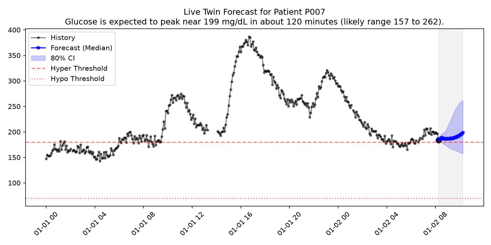

# DiaTwin: Patient-Specific Glucose Digital Twin

DiaTwin is an in-silico physiological simulator that models patient-specific glucose dynamics using a digital twin framework. It enables continuous glucose forecasting and treatment scenario simulation for diabetes management research.

**Disclaimer: This prototype operates exclusively on synthetic data and physiological approximations. It is a research tool, NOT a medical device. It must not be used for actual clinical decision making or patient care.**

**Live Demo**: [LIVE DEMO URL]
**Demo Video**: [VIDEO URL]

## Overview
DiaTwin models patient-specific glucose dynamics using a digital twin framework. It fuses static Electronic Health Record (EHR) profiles with real-time wearable sensor streams (CGM, heart rate, sleep, activity). The engine employs a calibrated risk model to predict hyperglycemic spikes. It features a What-if Simulator to explore the counterfactual impact of lifestyle interventions. A clinician-facing dashboard provides an interface to monitor the twin state, review forecast trajectories, and visualize the probabilistic effects of different scenarios. The architecture relies on an integrity-verified "frozen" model pipeline to ensure separation between retrospective training and prospective simulation.

## Results at a Glance

These metrics reflect the in-silico evaluation on synthetic patients. Test metrics use 6 test patients (34545 rows).

| Metric | Value | 95% CI | Source |
| :--- | :--- | :--- | :--- |
| **Risk Model AUC (Test)** | 0.925 | [0.907 - 0.944] | `reports/metrics_test_day7.json` |
| **Risk Model PR-AUC (Test)** | 0.682 | [0.565 - 0.797] | `reports/metrics_test_day7.json` |
| **Calibration Error ECE (Test)** | 0.0275 | - | `reports/metrics_test_day7.json` |
| **Risk Prevalence (Test)** | 0.148 | - | `reports/metrics_test_day7.json` |
| **Forecast RMSE 60m (Validation)** | 18.41 mg/dL | - | `reports/metrics_forecast_val.json` |
| **Forecast Coverage 60m (Validation)** | 80.0% | - | `reports/metrics_forecast_val.json` |

For the What-if Simulator test evaluation (6 test patients), the peak error is 1.0, 10.2 and 11.5 mg/dL for the three tested scenarios (`reports/WHATIF_TEST_DONE.json`). The 80% interval coverage is 0%, 17% and 0%. The uncertainty bands significantly under-cover. Forecast test metrics were not saved and a new held-out evaluation is planned.

## Scope & Decisions
- The model is for Type 2 diabetes and predicts a glucose rise of 50 mg/dL or more within 2 hours.
- The synthetic data differ from the real cohort in glucose level: mean glucose is 219.30 mg/dL in synthetic vs 141.01 mg/dL in the real cohort; time above 180 is 68.6% in synthetic vs 19.6% in the real cohort (from `reports/realism_comparison.json`, verified by `scripts/verify_real_independent.py`).
- The User Data Entry page provides an experimental, indicative estimate: sleep, heart rate and steps are filled with fixed placeholders when the user gives none (the sleep state "unknown" makes the history look like sleep in the features), history features are replaced by training medians, and the confidence is never "high" unless the full 24 hour history is provided.

## Architecture & Dashboards


*Data flows from raw synthetic streams through feature engineering to the frozen risk models and twin engine.*


*The Live Twin view displaying the real-time forecast and calibrated uncertainty bands.*

## Quick Start

### 1. Prerequisites
Ensure you have a supported Python release (Python 3) installed.

### 2. Clone and Install
```bash
git clone [REPOSITORY URL]
cd DiaTwin
python -m venv .venv
# On Windows:
.\.venv\Scripts\activate
# On macOS/Linux:
source .venv/bin/activate

pip install -r requirements.txt
```

### 3. Run the Demo Dashboard
To launch the Streamlit app locally using the precomputed demo bundle:
```bash
# Windows
$env:DIATWIN_DEMO_BUNDLE="1"
streamlit run app/main.py

# macOS/Linux
DIATWIN_DEMO_BUNDLE=1 streamlit run app/main.py
```

### 4. Run the Full Pipeline
To execute the end-to-end simulation, feature engineering, and model training pipeline:
```bash
python scripts/run_pipeline.py
```

### 5. Run the Test Suite
To run the tests, first install the development dependencies:
```bash
pip install -r requirements-dev.txt
pytest tests/
```

## Repository Layout
- `app/`: Streamlit dashboard entry points and page definitions.
- `configs/`: Pipeline configuration and feature definitions.
- `data/`: Raw and processed synthetic data (generated by the pipeline).
- `docs/`: Detailed architectural documentation and reports.
- `models/`: Frozen artifacts, model weights, and integrity manifests.
- `reports/`: Evaluation metrics, JSON insights bundles, and generated figures.
- `scripts/`: Executable scripts for training, calibration, and evaluation.
- `src/`: Core logic (data generation, forecasting, simulation, and twin state engine).
- `tests/`: Unit and integration tests for all modules.

## Evaluation Integrity
The project enforces a strict "freeze-before-test" protocol. For the risk model, the model freeze precedes its test evaluation in git history. For the forecast and what-if modules, the manifest and the test marker were committed together so freeze-before-test cannot be shown from git. Feature engineering logic explicitly enforces strict causal boundaries, preventing look-ahead bias in rolling windows. The dashboard relies on a display-only model, interacting only with a compiled insights bundle and the simulator engine. See [docs/INTEGRITY.md](docs/INTEGRITY.md) for full details.

## Limitations
This prototype is built on synthetic physiological approximations designed for research demonstration. It models a simplified representation of Type 1 and Type 2 diabetes dynamics and is not calibrated to true human physiology. The evaluation cohort is small (40 patients) and represents limited demographic diversity. The What-if Simulator uses the same underlying model family for both the baseline risk assessment and the counterfactual projection, which inherently limits the discovery of unmodeled physiological interactions. The prototype does not include medication modeling, insulin dosage simulations, or long-term complication risk factors. There is no clinical validation of the outputs.

## Real Data
The real dataset used in this project is ShanghaiT2DM (Citation: Zhao et al., Scientific Data 10, 35, 2023, DOI: 10.6084/m9.figshare.c.6310860). It is available under the CC BY 4.0 license.

## Tools and Acknowledgements
[TO BE FILLED BY TEAM: tools, libraries, data sources, mentors]

### Open Source Libraries
| Library | License |
| :--- | :--- |
| `streamlit` | Apache 2.0 |
| `xgboost` | Apache 2.0 |
| `pandas` | BSD 3-Clause |
| `numpy` | BSD 3-Clause |
| `shap` | MIT |
| `scikit-learn` | BSD 3-Clause |
| `pytest` | MIT |
| `hypothesis` | MPL 2.0 |

## Team and Contact
[TO BE FILLED BY TEAM: Member Names, Contact Information]

## License
See the [LICENSE](LICENSE) file for details.

## Real Data Attribution
ShanghaiT2DM dataset (Zhao et al., Scientific Data 10, 35, 2023; figshare DOI 10.6084/m9.figshare.c.6310860) is used for realism comparison. License: CC BY 4.0.
