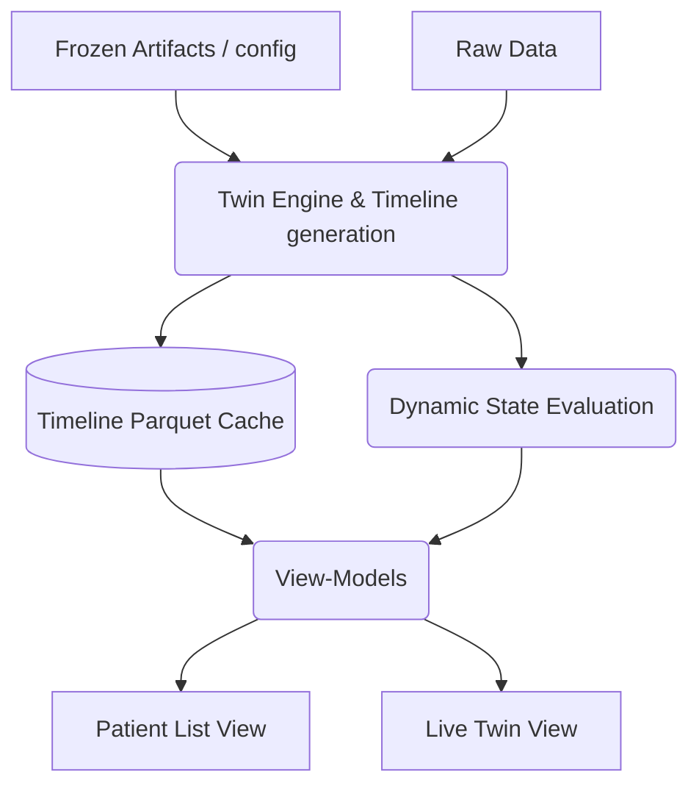

# DiaTwin Dashboard Architecture

## Page Map
1. **Patient List**: Overview of the demo patient cohort. Filterable by risk band and data status.
2. **Live Twin**: The core view of a patient's digital twin state at a specific point in time (the "as-of" time), showing KPIs, forecast, top drivers, alerts, and context.
3. **What-if Simulator**: Placeholder for What-if Simulator.
4. **Model Insights**: Placeholder for Model Insights.
5. **About**: Project information and disclaimers.

## Data Flow Diagram


## Panels & Provenance
- **Current Glucose & Trend**: Output from `TwinState.glucose_summary`, derived from the latest wearable samples.
- **Risk Band & Prob**: Calibrated outputs computed dynamically by the frozen pipeline and calibrator up to the as-of moment.
- **Predicted Peak**: Handled by the probabilistic forecaster.
- **TIR 24h**: Derived empirically from the past 24h timeline.
- **Forecast Chart**: 120-minute forward look (median and 10-90% bands) computed without any future leakage. The "Actual overlay" is explicitly tagged as evaluation-only.
- **Drivers**: SHAP values calculated from the feature space at the as-of moment.
- **Data Quality**: Computed by state estimation logic checking freshness, completeness, and warmup intervals.

## The Demo-Clock Concept
Instead of running in real-time, this prototype operates on an adjustable "as-of" clock. You can slide time back and forth to see exactly what the Twin would have computed at any moment based strictly on the available history up to that minute. 

## Honest-State Handling
- **Warming Up**: Banners explicitly indicate when the Twin is still in its warmup period and cannot output reliable predictions.
- **Stale/No Glucose**: Alerts are surfaced if data drops out.
- **Confidence Downgrades**: Data completeness directly impacts certainty reporting.

## Safety & Disclaimer Policy
**Strict separation:** The UI is purely a read-only presentation layer. It does not contain models, clinical logic, or treatment recommendations.
- All numbers are labelled as "estimates" or "suggestions".
- A prominent disclaimer remains visible at all times.
- Scenarios recommending insulin or medication changes are rejected at the engine level.

## How to Run
```bash
streamlit run app/main.py
```

## Demo Bundle Building (For deployment)
```bash
python scripts/build_demo_bundle.py
```
This generates a static precomputed snapshot of timelines and states for demo patients (useful for headless demo instances). Toggle `use_demo_bundle: true` in `config.yaml` to switch to demo mode.

## Insights Bundle Building (Model Insights page)
```bash
python scripts/build_insights_bundle.py
```
This script acts as a compiler, reading existing static reports (JSON, CSV, Parquet) and producing `reports/insights_bundle.json`.
**Display-only rule:** The `Model Insights` and `About` pages *never* load models, *never* run evaluations, and *never* see raw patient data. They simply read `insights_bundle.json` through `src/app_lib/insights_vm.py` and display the stored results.

## Model Insights Page
Displays exactly what is stored in the bundle across multiple tabs (Risk Model, Calibration, Explainability, etc.). Integrity panel automatically verifies file hashes and `freeze_before_test` git commit lineage.

## About Page
Displays project context, challenge mapping, glossary, and guided demo steps. Configuration options like team members and contact email can be set in `config.yaml`.

## Known Limitations
- Static charts lack full interactivity beyond standard Plotly zooming.
- UI does not auto-refresh dynamically in a real-time setting.
- The Model Insights page cannot fill in metrics if the source report files were not generated during earlier evaluation steps.
