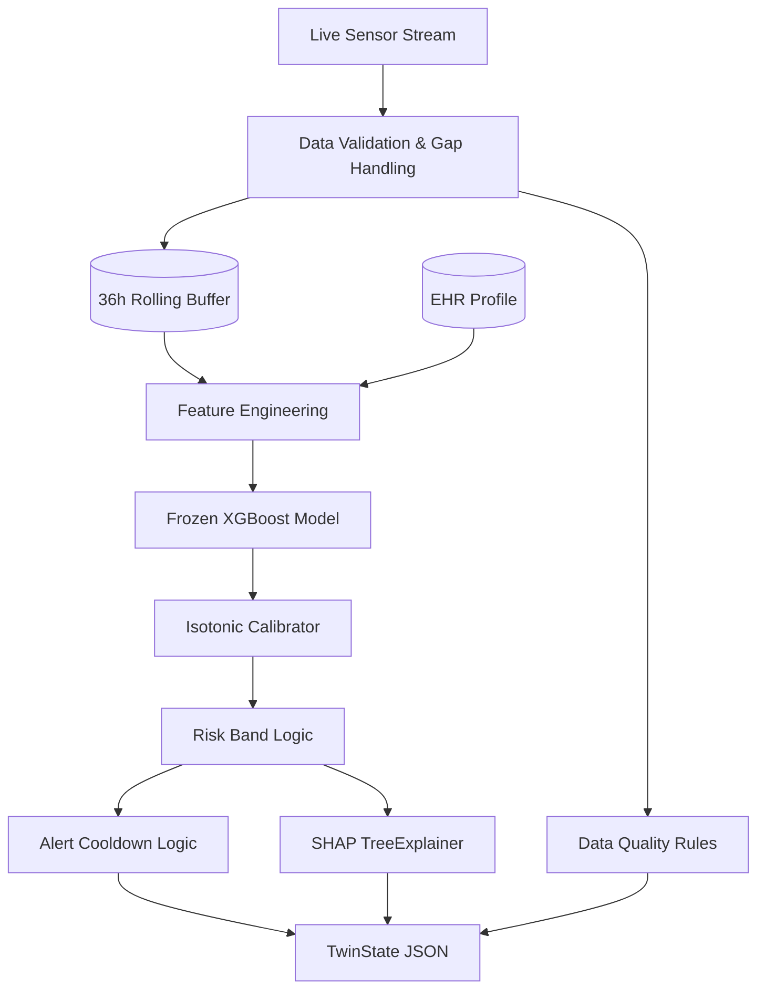

# DiaTwin: Digital Twin State Engine

The Digital Twin State Engine is the core runtime component of the DiaTwin project. It represents a single patient's continuous metabolic state, fusing static Electronic Health Record (EHR) data with streaming wearable sensors.

## Architecture



## Features

1. **Parity Guarantee**: The engine is guaranteed to produce the exact same feature vector as the offline batch processing pipeline (tolerance `1e-6`). This is continuously verified via `test_twin_parity.py`. Cumulative features that require histories beyond the rolling buffer (e.g., `meal_min_since_last`, `miss_min_since_last_obs`) are explicitly persisted in the Twin's state memory.
2. **Frozen Artifacts**: The engine loads the final model artifacts and asserts their cryptographic SHA-256 hashes against `models/FROZEN.json`. Any mismatch prevents the engine from booting, preventing unintentional regressions or data leakage.
3. **Causality**: The engine runs strictly forward in time. It rejects late or out-of-order samples and cannot peek into the future. It never sees true labels, simulation archetypes, or hidden physiological parameters.
4. **Data Quality & Fault Tolerance**:
   - **Gaps**: If the stream jumps by more than 5 minutes, the engine automatically inserts padded 5-minute intervals with `NaN` glucose and `unknown` sleep states to maintain the strict temporal grid required by the feature engineer.
   - **Stale Data**: If no glucose is observed for 20+ minutes, `data_quality.status` degrades to `stale` and confidence drops.
   - **Corrupt Data**: Out-of-bounds glucose values (e.g. -5 mg/dL) are caught, flagged as warnings, and treated as `NaN` to avoid skewing predictions.
5. **Alert Fatigue Prevention**: Alerts are rate-limited via a configurable cooldown (e.g. 60 minutes), unless the risk escalates to a higher severity band.

## The TwinState Schema

The engine outputs a fully serialized `TwinState` object on every step.

```json
{
  "profile": {
    "patient_id": "P026",
    "age": 59.5,
    "sex": "F",
    "bmi": 28.1,
    "hba1c": 6.8,
    "diabetes_duration_years": 8.0,
    "on_insulin": 0,
    "on_metformin": 1,
    "hypertension": 1
  },
  "latest_measurement": {
    "timestamp": "2026-01-01T21:20:00",
    "glucose_mgdl": 142.3,
    "heart_rate": 78.0,
    "steps": 0.0,
    "sleep_state": "awake",
    "meal_carbs_g": 0.0,
    "activity_intensity": 0.0
  },
  "risk": {
    "probability_calibrated": 0.812,
    "probability_raw": 0.451,
    "band": "High",
    "band_thresholds": {
      "Medium": 0.1538,
      "High": 0.3158
    },
    "drivers": [
      {
        "feature": "meal_min_since_last",
        "feature_value": 45.0,
        "shap_value": 0.52,
        "direction": "increases risk",
        "human_readable": "A meal was consumed very recently"
      }
    ],
    "model_version": "v1"
  },
  "data_quality": {
    "status": "ok",
    "minutes_since_last_glucose": 0.0,
    "completeness_60m": 1.0,
    "history_hours_available": 36.0,
    "warnings": [],
    "confidence": "high"
  },
  "forecast": {
    "status": "ok",
    "horizons_minutes": [15, 30, 60, 90, 120],
    "quantiles": {
      "0.1": [140.0, 135.0, 120.0, 110.0, 100.0],
      "0.5": [150.0, 155.0, 140.0, 130.0, 120.0],
      "0.9": [160.0, 175.0, 160.0, 150.0, 140.0]
    },
    "trajectory_5min": {
      "timestamp": ["2026-01-01T21:20:00", "2026-01-01T21:25:00"],
      "median": [142.3, 145.0],
      "lower": [142.3, 141.0],
      "upper": [142.3, 149.0]
    },
    "predicted_peak": 155.0,
    "predicted_peak_minutes": 30,
    "predicted_min": 120.0,
    "predicted_min_minutes": 120,
    "hypo_risk_flag": false,
    "hyper_risk_flag": false,
    "time_above_180_expected_minutes": 0.0,
    "agreement_with_risk_band": true,
    "model_version": "v1",
    "summary": "Glucose is expected to peak near 155 mg/dL in about 30 minutes (likely range 135 to 175)."
  },
  "forecast_status": "ok",
  "active_alert": {
    "timestamp": "2026-01-01T21:20:00",
    "band": "High",
    "probability": 0.812,
    "message": "High risk detected (81%).",
    "acknowledged": false
  },
  "glucose_summary": {
    "current_glucose": 142.3,
    "trend_30m": 15.2,
    "trend_direction": "rising_fast",
    "time_in_range_24h": 0.85
  },
  "context": {
    "minutes_since_last_meal": 45.0,
    "carbs_on_board_estimate": 32.5,
    "minutes_since_last_activity": 120.0,
    "sleep_state": "awake"
  },
  "timestamp": "2026-01-01T21:20:00",
  "engine_version": "1.0.0"
}
```

## Known Limitations
- The engine uses a 36-hour buffer. If a patient consumes a meal and then has no data or meals for over 36 hours, the system maintains the memory of that meal timestamp via explicit cumulative tracking, but it cannot replay the exact features natively if the buffer is cleared.
- AppLocker / WDAC policies on certain Windows machines may block the `HDBSCAN` DLL required by the `shap` explainer library. If blocked, `drivers` will be returned as an empty list to prevent crashes.
- Forecasting operates on the same feature vector built for the risk score classifier to save computation. Latency can slightly increase due to evaluating 15 XGBoost quantiles.
